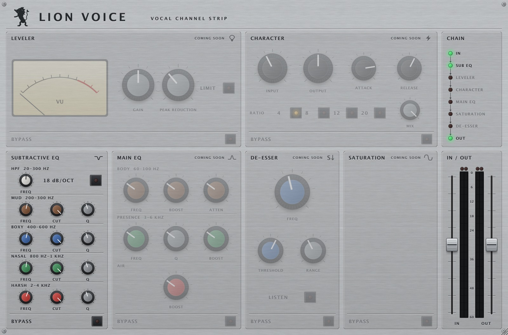

# Lion Voice

A vocal channel strip plugin (VST3 / AU) that performs a complete vocal mix in one place, styled like an SSL console:
brushed-steel faceplate, SSL-style knobs and a heraldic lioness, the symbol of Brescia, engraved in the steel.



> **Status: MVP 1 (v0.1.0).** The full interface is in place; the input/output gain stages, meters and the
> subtractive EQ process audio. The other modules are shown as "coming soon" and arrive in the next releases.

## Signal chain

```
IN gain → Subtractive EQ → Leveler (LA-2A style) → Character comp (FET style)
        → Main EQ → Saturation → De-esser → OUT gain
```

The module order is fixed. Every module except IN/OUT gain has its own bypass switch, and a chain panel lights up
the modules that are currently active.

## Modules

| Module | What it does | Status |
|---|---|---|
| IN / OUT gain | Faders (−24…+24 dB) with peak/RMS meters, peak hold and clip LEDs. Always active. | ✅ v0.1 |
| Subtractive EQ | High-pass filter (12/18 dB/oct) and four cut bands: mud (200–300 Hz), boxiness (400–600 Hz), nasality (800 Hz–1 kHz), harshness (2–4 kHz). | ✅ v0.1 |
| Leveler | Slow, smooth optical-style compression (LA-2A inspired) to even out the performance. | next (v0.2) |
| Character comp | Fast FET-style compression (1176 inspired) to control peaks and add attitude. | next (v0.2) |
| Main EQ | Body (Pultec-style low shelf), Presence (3–6 kHz) and Air (soft high shelf). | next (v0.2) |
| Saturation | Harmonic colour. | planned |
| De-esser | Dynamic-EQ de-esser with a listen mode to find the sibilance. | planned |

Lightweight: the current chain uses well under 1 % of one CPU core.

## Requirements

- macOS (Apple Silicon or Intel)
- Xcode Command Line Tools (`xcode-select --install`)
- [CMake](https://cmake.org) ≥ 3.25 and [Ninja](https://ninja-build.org): `brew install cmake ninja`
- Optional: [pluginval](https://github.com/Tracktion/pluginval) for validation
- Optional editor setup: VS Code with the CMake Tools, clangd and CodeLLDB extensions

## Getting the code

JUCE is included as a git submodule, so clone recursively:

```sh
git clone --recursive https://github.com/marcofranceschini015/vst-lion-voice.git
cd vst-lion-voice
```

If you already cloned without `--recursive`:

```sh
git submodule update --init --recursive
```

## Building

| Task | Command |
|---|---|
| Configure (debug, native arch) | `cmake --preset debug` |
| Build | `cmake --build --preset debug` |
| Run the tests | `ctest --preset debug` |
| Release build (universal arm64 + x86_64) | `cmake --preset release && cmake --build --preset release` |
| Validate the plugin | `scripts/validate.sh` |

In VS Code the CMake Tools extension picks up the presets automatically: build with `F7`, and start the standalone
app under the debugger with `F5`.

Every build copies the plugin to:

- `~/Library/Audio/Plug-Ins/VST3/Lion Voice.vst3`
- `~/Library/Audio/Plug-Ins/Components/Lion Voice.component` (Audio Unit)

A standalone app is also built, which is handy for quick tests without a DAW.

## Using it in a DAW

- **REAPER:** Options → Preferences → Plug-ins → VST → *Re-scan*, then insert *Lion Voice (Marco Franceschini)* on a vocal track.
- **Logic Pro / GarageBand:** the Audio Unit appears under *Audio Units → Marco Franceschini → Lion Voice*.
  If a new build does not show up, run `killall -9 AudioComponentRegistrar` and restart the host.

### Quick guide

1. **IN fader:** play the vocal and set the input so its peaks land in the green marks of the IN meter
   (−12 to −10 dBFS).
2. **High-pass (HPF):** start around 80–90 Hz for a male voice, 100–120 Hz for a female voice; raise it until the
   voice starts to thin out, then back off a little.
3. **Cut bands:** set a band's CUT to about −8 dB and sweep its FREQ to find the problem (mud, boxiness, nasality,
   harshness), then reduce the cut until it sounds natural. Q sets how wide the cut is.
4. **OUT fader:** match the loudness of the bypassed signal, then use the BYPASS key to compare honestly.

Tips: double-click any knob or fader to reset it; click a meter to clear its clip LEDs; drag the bottom-right
corner to resize the window (70–150 %).

## Project layout

```
CMakeLists.txt, CMakePresets.json   build configuration
libs/JUCE/                          JUCE framework (git submodule)
src/                                plugin processor, editor, parameters
src/dsp/                            DSP code, independent of JUCE and the GUI
src/gui/                            look-and-feel, panels, meters, logo
tests/                              Catch2 tests: DSP units and the whole plugin
tools/                              developer tools (GUI snapshot renderer)
assets/                             images used by this README
scripts/                            helper scripts (validation)
```

## Roadmap

1. **MVP 1 (v0.1):** complete interface, IN/OUT gain and meters, subtractive EQ.
2. **MVP 2 (v0.2):** Leveler and Character compressors with gain-reduction meters, Main EQ.
3. **MVP 3:** saturation and de-esser.
4. Later ideas: automatic input analysis, macro controls, an assistant that suggests a full mix.

Reverb, delay and stereo effects are out of scope and will live in a separate plugin.

## License

Lion Voice is free software, released under the **GNU Affero General Public License v3.0**. See [LICENSE](LICENSE).

It is built with [JUCE](https://juce.com), used under its AGPLv3 licence, and the
[VST3 SDK](https://github.com/steinbergmedia/vst3sdk) (MIT). VST is a registered trademark of Steinberg Media
Technologies GmbH.

## Author

Marco Franceschini
